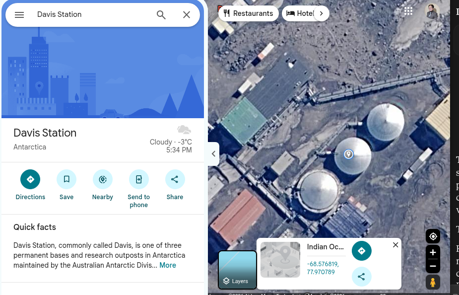

## Challenge

Not all adventures come with a map, and not every destination is easy to explain. Sometimes, you've just got to trust your sense of direction. Good luck keeping your bearings!

Flag Format is `CURTIN_CTF{redacted}`

### Challenge Image



*Satellite image showing a research base on bare, ice-free rock with rainbow-painted buildings, three large silver domed fuel tanks, a radome, antenna arrays, a meltwater tarn, and coastal sea with an iceberg.*

## Approach

### Phase 1 — Analyze

1. Examined the provided satellite image (`Untitled.png`): ice-free rocky terrain, dense cluster of rainbow-painted buildings, three large silver domed fuel tanks, a radome, antenna arrays, a meltwater tarn (lake), and coastal sea with an iceberg visible.
2. Noted the prompt hint: *"keep your bearings"* — flags that the image is **rotated** (north is not up), so apparent sea direction cannot be trusted for orientation.

### Phase 2 — Recon

3. Ran reverse image search (Google Lens / Yandex) on the screenshot → identified **Davis Station**, Australia's year-round research base on the ice-free Vestfold Hills, Ingrid Christensen Coast, Princess Elizabeth Land, Antarctica.
4. Cross-checked distinctive features against known Antarctic stations:
   - Australian stations are painted in distinct bright colours ✓
   - Three large silver domed fuel tanks matching Davis's fuel farm ✓ (Casey has 11 cylindrical tanks; Zhongshan has 6 opera-mask-painted tanks — both ruled out)
   - ANARESAT radome and antenna farm / riometer / LIDAR present ✓
   - "Station Tarn" meltwater lake in an ice-free coastal oasis ✓
5. Looked up UN/LOCODE for Davis Station at `service.unece.org/trade/locode/aq.htm` (country code `AQ`) → **`AQ DAV`** → formatted as `AQDAV`.

### Phase 3 — Infiltrate (compute the Plus Code)

6. On Google Maps satellite view, identified the three fuel tanks as the central feature of the image and dropped a pin on them → coordinates **`-68.576819, 77.970789`**.
   - Key nuance: the station *label* coordinate (~`77.967°E`) is **not** where the image is centred — the three fuel tanks sit ~0.003° east. Using the label coord gives a wrong Plus Code.
7. Google Maps doesn't display a Plus Code for that remote location, so computed the Open Location Code (Plus Code) manually from `-68.576819, 77.970789` → **`3J3VCXFC+78`**.
8. Assembled the flag: `CURTIN_CTF{redacted}`.

## Tools

- Google Lens / Yandex Images — reverse image search to identify the station
- Google Maps satellite view — pin the exact feature coordinates
- Open Location Code calculator — compute Plus Code from coordinates
- UN/LOCODE database (`service.unece.org/trade/locode/aq.htm`) — look up station locode

## Lessons

- Antarctic stations are well-indexed online — reverse image search nails the base fast; then confirm with distinctive features (fuel-tank count, radomes, building colours).
- UN/LOCODE list for Antarctica is published under country code `AQ`.
- Plus Codes are point-specific: pin the **exact feature shown**, not the place label, before reading/computing the code. A ~0.003° offset can change the Plus Code entirely.
- "Keep your bearings" prompt hints at image rotation — never trust apparent compass direction from a satellite image without verifying.

## Flag

```
CURTIN_CTF{redacted}
```
